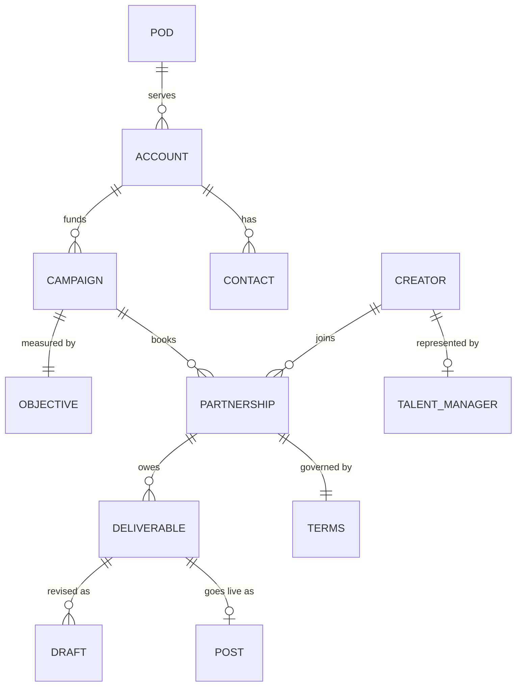

# Problem framing (working draft)

The initial thesis, organized and tested against public research. Sources live in [research.md](research.md); the workflow diagrams live in [../flows.md](../flows.md). Verdicts: ✅ holds, 🔶 holds with a correction, ❌ does not hold as stated.

## 1. The thesis in one paragraph

A Services campaign manager runs a **two-sided matchmaking business**: brands bring business objectives, creators bring audiences, and the human's job is to make good matches and then deliver them — on time, on brief, on budget — while keeping both sides' trust. Most of the day is lost to coordination (chasing, tracking, status updates), not judgment. The agent should absorb the coordination, **prepare** the judgment calls so they take seconds instead of minutes, and escalate the moments that genuinely need a human voice. The interface is a **state-driven workspace** (what needs me, why, and what I need to decide it), not a chat window.

## 2. Domain model and terminology

The hierarchy is CRM-like, as suspected, but two corrections matter.

| Term | Meaning | Later's own word |
| --- | --- | --- |
| Campaign manager (CM) | The human accountable for delivery. The exercise term. | **Account Manager** owns a "portfolio" of accounts; Coordinators and Co-Ops execute under them |
| Pod | The team serving an account: AM, coordinators, talent partnerships, with strategy, paid media and creative alongside | "account pod" |
| Account | The brand client (e.g. a CPG brand) and its contacts | client, customer, brand |
| Campaign | One program with one objective, budget, and timeline | campaign, program |
| Creator | The talent | creator (newer), influencer (older) |
| Partnership | A creator booked on a campaign, with negotiated terms | — (*invented term*; Later tracks creators through workflow stages) |
| Terms | Fee, deliverables, usage rights, whitelisting rights, exclusivity, disclosure | contract, incentives, usage rights |
| Deliverable | A unit of content owed: "1 TikTok + 2 Stories" | deliverables |
| Draft review | Brand/AM review of content before posting | Approved / Approved with Corrections / Needs Work |
| Wrap report, SBR | End-of-campaign report; strategic business review with the client | same |

**Correction 1: the unit of daily work is smaller than the campaign.** It is *creator × deliverable × stage*, plus budget pacing. A campaign with 30 creators and 3 deliverables each is ~90 things moving through a 12-stage workflow. That is where the coordination load comes from.

**Correction 2: it is a pod, not one person.** The AM delegates execution to coordinators and quality-checks their work. That matters for the agent: it is effectively **another member of the pod** — an extremely fast coordinator — and the AM already knows how to supervise one. That's a useful mental model for trust: "review the agent the way you'd review a new coordinator."

## 3. Testing the assumptions

| # | Assumption | Verdict | What the research says |
| --- | --- | --- | --- |
| A1 | It's CRM-like: AM → accounts → campaigns → creators/content | 🔶 | Right shape, but pod-based, and the working unit is creator × deliverable × stage (§2). |
| A2 | The human's core value is matching creators to campaigns | 🔶 | Matching matters, but Later has a dedicated **Talent Partnerships** casting role and is pushing matching into AI (EdgeAI, Brand Suitability Insights). Public AM job descriptions emphasize **client trust, on-time/on-brief delivery, compliance, turning data into insight, renewal/expansion**. Reframe: the human's value is **judgment and trust on both sides** — matching is one expression of it. |
| A3 | Pivot after ~20% of budget is spent and KPIs lag; AM authorizes the next tranche | ❌ | No evidence of tranche release or a 20% trigger. Creator fees are mostly committed at contracting (flat fee or 50/50). The documented flex is: **(a) a paid amplification reserve** used to boost top organic posts within 48–72h (Later's Crumbl and Chobani case studies), **(b) swapping or adding creators**, **(c) scaling top creators and dropping underperformers** in the next wave. Later calls this **budget pacing**. The decision moment is real; the mechanism is different. |
| A4 | Second side: new creators arrive seeking partnerships and must be vetted | 🔶 | Real, but largely a **separate org and product** (Creator Operations, the Later Creator app / Mavely, HubSpot). For Services it shows up as (a) creators in a campaign's **Applied** stage and (b) the pod's **roster** of known, trusted creators. The creator-side view for a CM is "my bench," not an intake funnel. |
| A5 | Deadline reminders can run on a cron; escalate to a human ~3 days out | ✅ | Matches recruiting automation ("notify recruiter if no activity in 3 days") and Later's own workback (brief T-14, draft T-7, approval T-3, live T-0). **Refinement:** escalate against the *draft* deadline, not go-live, and weight by slack, substitutability, and the creator's history. Missing T-7 is the real alarm. |
| A6 | Showing the right information the right way compresses review (as in Meridian/Tyrell) | ✅ | Strongly supported. Recruiting agents converged on **per-criterion evidence** ("met / partly / not met") instead of a single score; HAX G11 ("make clear why") is the most-violated guideline. |
| A7 | A library of state-driven widgets beats fixed pages | ✅ | Consistent with sales/CS tooling: Gong's tunable deal warnings, HubSpot health bands that create tasks only on band change, Salesforce Next Best Action cards with accept/reject. The model *selects and fills* curated widgets; it does not generate UI ("Generative UI Is Three Things. Only One Ships."). |
| A8 | Client-centric primary view, creator-centric secondary | ✅ | AMs are measured per account (renewal, expansion), so client-centric fits. Creator view = roster/bench, with reliability history. |
| A9 | Chat is secondary to analysis, summaries, focused UI | ✅ | "Chat is a good input primitive but a bad operating environment for agents" (Crosley), and the same argument in "Chat Is an Input, Not an Interface." Keep a command/ask affordance; don't make it the home screen. |
| A10 | It resembles recruiting more than a marketplace | 🔶 | Holds for matching (job order ≈ brief, talent pool ≈ roster, internal submittal gate ≈ AM review before the brand sees a lineup). **Breaks** on two points: a placement ends at hire, but a booking starts a production tail (drafts, revisions, compliance, go-live, reporting); and creators are repeat suppliers booked by competing brands, so conflicts and reliability matter more. |

## 4. What the thesis is missing

These came out of the research and aren't in the original notes. Several are better "hard moments" than the obvious ones.

1. **Rights are separate, priced, and time-boxed.** Usage rights, whitelisting/Spark/Partnership Ads permissions, and exclusivity are negotiated separately. If whitelisting wasn't contracted, the "boost the top post" pivot can't happen. If it expires mid-flight, ads silently stop.
2. **The brand is also a source of delay.** Brand review and (in regulated categories) legal review are separate gates with their own SLAs. Most delay comes from feedback loops, not creators. The agent should chase *the brand* too, politely.
3. **FTC disclosure is ongoing liability.** The brand (and therefore the agency) shares liability. Checking disclosure at draft review isn't enough; the live post must be checked too.
4. **Gifting ≠ paid.** Seeded product carries no posting obligation (post rates ~10–40%). Different expectations, different chasing rules.
5. **Payment is a relationship lever.** Late payment is common and creators remember it. The agent should chase *internal* payment approvals as hard as it chases creators.
6. **Macro creators come through talent managers.** Different counterpart, different tone, own approval loop.
7. **Client reporting is a deliverable, not overhead.** Status updates, wrap reports and SBRs drive renewal. Drafting them is ideal agent work; the narrative ("why this matters") stays human.
8. **Measurement is contested.** EMV is widely criticized (Later still reports it via the Ayzenberg index); promo codes under- and over-count. The KPI framework must be agreed with the client up front, and the agent should not imply false precision.
9. **Competitors' agents all live at the front of the funnel** (discovery, outreach, shortlists). The middle of the campaign — deliverable tracking, brief compliance with evidence, live-post QA, feedback consolidation — is still manual everywhere. That is exactly what the exercise asks about, and it is where Later Services can differentiate.

## 5. Who does what: the autonomy split

A first pass, using the pattern the recruiting industry converged on: **automate logistics, the agent proposes judgment calls, and every external voice and every dollar is gated until trust is earned.** Autonomy is set **per action type**, not globally, and can be raised or revoked.

| Work | Agent acts alone (logged, undoable) | Agent proposes, CM approves | Always human |
| --- | --- | --- | --- |
| Objective → KPIs | Pull benchmarks for category/tier | Draft KPI framework and targets from the brief | Agree targets with the client |
| Matching | Rediscover past creators; screen for conflicts and brand safety | Lineup with per-criterion evidence; backups | Final lineup; anything taste- or relationship-based |
| Terms | Track rights expiry; flag missing whitelisting | Offer within the approved rate band | Out-of-band rates, exclusivity, contracts |
| Production | Reminders on cadence; receipt tracking; status updates to pod | Brief-compliance check with evidence; consolidated brand feedback | Creative judgment; calling a quiet creator |
| Go-live | Verify post is up with link, code, tags, disclosure | Fix requests for non-compliant posts | — |
| Optimization | Daily pacing vs. forecast | "Boost these 3 posts with $X from reserve"; "swap creator B for C" | Spend from reserve above threshold; dropping a creator |
| Client comms | Assemble data for status and wrap reports | Draft status update and wrap report | Send to client (initially); SBR narrative |
| Payments | Chase internal approvals | Release payment on verified delivery | Disputes, withholding |

## 6. Order independence and concurrent updates

Most of what a campaign needs can arrive in any order, from several people at once. Ana's rate, her usage-rights scope, her shipping address and her disclosure acknowledgement can land in any sequence. The CM, a coordinator, the agent and the brand may each touch the same partnership in the same hour, often as part of larger batches that overlap: the CM approves a lineup that includes Ana while a coordinator confirms her offer and the agent's daily run sends her a reminder. The system has to give the same result regardless of order or repetition, and it has to surface real disagreements instead of letting the last writer win. This applies "Idempotent Design: When Order Shouldn't Matter."

**Principles**

1. **Milestones gate on sets, not sequences.** Each milestone (ready to brief, lineup approved, ready to post, ready to pay) is a checklist of facts and decisions. Inside a milestone, collect them in any order; the milestone opens when the set is complete. Any required order that exists only because of the data model (for example "contract before rate entry") is a shadow constraint and should be removed.
2. **Every update is keyed, so repeats are no-ops.** A fact is identified by what it is about and what it says, such as *Ana / deliverable 2 / brand approval*. Recording the same value twice changes nothing. It also leaves an attribution trail, so the second person sees "already approved by Priya, 10 min ago" instead of a duplicate action.
3. **External effects are idempotent by construction.** Messages, offers and payments are the irreversible actions. Each carries an idempotency key, such as *reminder / deliverable 2 / T-8*, so a retried agent run, a re-run schedule or two people clicking "nudge" never double-message a creator or double-pay. A double-sent reminder is the most visible way this design can fail, and a creator notices it immediately.
4. **Writes say what they were based on.** An update carries the version its author saw. If the fact has changed since then, the update becomes a **conflict card** rather than an overwrite. The card shows both values, who made each change, when, and why. Authority (client > CM > coordinator > agent) can settle a conflict automatically only when the rule is explicit and logged. Decisions are never settled silently by timestamp.
5. **Proposals expire when their inputs change.** Each agent proposal records the facts it used. If Ana submits her draft while a "swap Ana for Ben" card waits in the queue, the card withdraws itself and says why. A batch approval skips items that are already resolved or stale, and reports what it skipped.
6. **Passing a milestone seals what came before it.** Once the lineup is approved and sent to the client, changing a member means explicitly reopening that milestone, which is visible and attributed. Changes after a milestone never mutate earlier decisions quietly.

**Why this belongs in a UX brief.** These are trust mechanics. A CM can only delegate to an agent, and share work across a pod, if repeats are safe and disagreements are visible. "Already handled" and "this changed while you were looking" are the two states this produces in the interface. Both should be first-class widget states.

## 7. Experience concepts

**Hierarchy of cognition** (as with Reva): *what needs me → why → what I need to decide it → do it.*

- **Today** (cross-account): a sized **decision queue**, not a feed. Each item is a card with the agent's proposal, its evidence, its confidence, and accept / edit / reject. Ordered by consequence × time-to-deadline, not recency.
- **Account** (primary view, e.g. a beverage brand): health of all campaigns against their objectives, budget pacing, what's waiting on the client, what's waiting on us.
- **Campaign**: the creator × deliverable board by stage, with named risk warnings (Ghosted, Draft overdue, Brand feedback stalled, Rights expiring, Post missing, Below forecast).
- **Roster** (secondary view, creator-centric): the bench. Reliability (on-time rate, revisions, responsiveness), audience fit, past performance, conflicts, relationship notes. No platform exposes a reliability score today; the agent produces this data naturally while chasing.
- **Agent log**: what the agent did on its own, with undo. This is how trust is earned and audited.

**One widget, many states.** A campaign widget renders differently depending on what the campaign needs: "approve lineup," "review 4 drafts," "Creator X is quiet, draft due in 2 days," "top post is outperforming, boost?" The widget library is the reusable pattern set, and the strongest answer to the brief's question about standardizing patterns across several agents. It only stays standard if someone owns it as a permanent function ("Owning the Design System").

**Chat** is a command/ask affordance (e.g. "why did you rank her above him?", "draft a note to the client about the delay"), scoped to the current object. It is not the home screen.

## 8. Scoping for the prototype

The brief requires: **state the goal**, **review the proposed lineup**, and **one hard moment**.

- **State the goal** → the demand-side flow: objective → KPI framework → constraints. The agent drafts; the CM edits and confirms.
- **Review the lineup** → the matching flow: per-criterion evidence, roster rediscovery, conflicts, backups, and the internal gate before anything reaches the brand.
- **Hard moment** → **a creator goes quiet with a deadline close.** It uses the cron-plus-escalation idea, shows the autonomy ladder end to end (agent nudges alone → agent escalates → human calls), and connects to the roster (reliability history) and to the client (do we tell them, and what do we say). The candidate twist: the best fallback is a **backup from the approved lineup**, which pays off the lineup review earlier in the demo.

**Probable cuts** (to state in the brief; rank candidate agent tasks with CFS, Commonality × Frequency × Severity, so the cuts are defensible): creator intake funnel (separate org), contracting and payments UI, paid media buying, the full analytics surface, real LLM integration.

## 9. Open questions

1. How much of the pod does the agent replace versus amplify? (Coordinator workload is the obvious target; say so carefully.)
2. Does the brand see the agent at all, or only the agency's output? (Recommendation: the brand sees only what the CM puts their name on.)
3. Where is the line for autonomous external messages? Reminders to creators feel safe; anything to the client does not, at first.
4. How do we show confidence without false precision, especially on performance forecasts?
5. How does autonomy get *earned*: per CM, per account, per action type? What's the revocation path after a mistake?
6. What is the authority order for automatic conflict resolution, and which fact types must never resolve automatically? (Draft answer: money, rights and anything client-facing always go to a human.)
