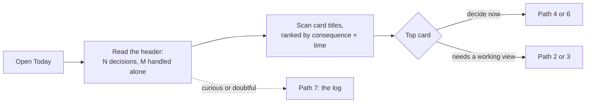
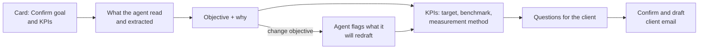
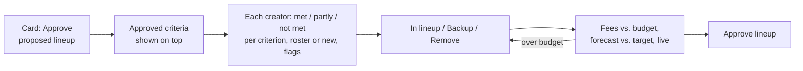
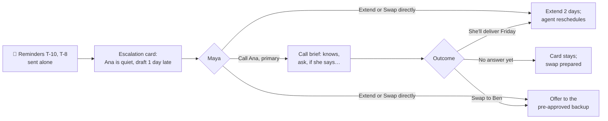

# Key path analysis

The few paths through the product that have to work for the primary persona (Maya, the Account Manager; see [personas.md](personas.md)), step by step. Each path comes from the [story map](story-map.md) and points to the prototype screen that supports it. The prototype builds paths 1–4 and shows path 5 as a live code change. Paths 6–7 are analyzed so that the patterns used in the prototype are known to hold for them, but they are not built.

For each path: the trigger, the steps, what the agent has already done, the one decision Maya makes, where it can fail, and how we'd know it works. Time targets are *Invented* hypotheses to test, not measurements.

| # | Path | Mode | Pattern | Prototype | Why it's key |
| --- | --- | --- | --- | --- | --- |
| 1 | Start the day | both | Decision queue | `#today` | Every session starts here; it carries the agent's credibility |
| 2 | State the goal | design time | Approve a plan | `#goal/cmp-spring-serum` | Required by the brief; every later step is judged against it |
| 3 | Review the lineup | design time | Approve a plan | `#lineup/cmp-holiday-gifting` | Required by the brief; sets up the backup the hard moment uses |
| 4 | A creator goes quiet | run time | Decide an exception | `#today`, top card | Required by the brief; the most frequent high-severity exception |
| 5 | Tune the agent | both | Tune, don't just correct | `AGENT_POLICY` (live edit) | How autonomy is earned; the factory's "tune the robot" loop |
| 6 | Review a draft | run time | Decide an exception | `#today`, draft card | The draft checker exists today; exceptions-first is the open UX question |
| 7 | Audit the agent | both | Activity | `#activity` | Trust is earned by being able to check |

## Path 1: Start the day

**Trigger.** Maya opens the product between calls. **Goal.** Know what needs her, in what order, in under a minute.

| Step | What Maya sees | Agent has already | Her decision | Can fail if | Measure |
| --- | --- | --- | --- | --- | --- |
| Open Today | Count of decisions and of things handled alone | Ranked every open item across accounts | Where to start | The count is high and nothing is urgent (queue fatigue) | Time to first action < 60 s |
| Scan | Cards that stand alone: account · campaign, title, severity in words | Written the title as what happened | Which card first | Titles describe a category ("Deliverable at risk"), not a fact | Picks the top card > 80% of the time |
| Go | One primary action per card | Prepared the follow-through | Act or open the working view | Two equally loud buttons; labels that look like navigation | Wrong-card clicks; back-outs |

**Design consequences.** Rank by consequence × time, not recency. Every card names the person and the deadline. The header says what the agent did alone, so Maya knows the queue isn't everything. Compact cards below the fold keep the list scannable at 100-creator scale.

## Path 2: State the goal (design time)

**Trigger.** A new brief arrives; the agent has drafted the goal. **Goal.** A KPI framework Maya would put her name on, ready to take to the client.

| Step | What Maya sees | Agent has already | Her decision | Can fail if | Measure |
| --- | --- | --- | --- | --- | --- |
| Check inputs | Source list and extracted facts | Read the brief and call notes | Did it miss anything? | Extraction is wrong and looks confident | Edits to extracted facts |
| Objective | Proposed objective and the reason | Matched brief language to an objective | Keep or change | The reason is generic | Objective changes per goal |
| KPIs | Editable targets beside the benchmark and method | Picked benchmarks for category and tier | Adjust targets | Benchmarks imply false precision | Target edits; client renegotiations later |
| Gaps | Drafted clarifying questions | Found what the brief leaves open | Which to send | Questions the client already answered | Questions removed |
| Confirm | "Confirm and draft client email"; "Targets are agreed with the client, not here" | — | Ready for client | Maya reads "Confirm" as final | Goals reopened after the client call |

**Design consequences.** Show inputs before outputs, so a missed input is visible. Changing the objective is allowed and its knock-on effects are stated in place. The gate's label says what it does, and a note says what it doesn't.

## Path 3: Review the lineup (design time)

**Trigger.** Criteria approved; the agent proposes a lineup. **Goal.** A lineup with backups that Maya can defend to the client, within budget.

| Step | What Maya sees | Agent has already | Her decision | Can fail if | Measure |
| --- | --- | --- | --- | --- | --- |
| Criteria | The criteria she approved earlier | Searched roster first, then the index | — | Criteria aren't visible, so evidence can't be checked | — |
| Evaluate | Per-criterion evidence, roster badge, conflict flag | Screened for conflicts and safety; started the conflicted creator as removed | Who's in, who's backup | A single score hides why | Time per creator; "ask why" uses (R1) |
| Adjust | Live totals | — | Trade fee against reach | Totals lag or hide the cap | Over-budget attempts |
| Approve | "Approve lineup"; "Nothing goes to the client until you present it" | — | Internal gate | Disabled without a reason | Lineups reopened after approval |

**Design consequences.** Criteria before candidates. No fit score. A backup chosen here is what makes path 4 one click: the two paths are designed together.

## Path 4: A creator goes quiet (run time, the hard moment)

**Trigger.** The agent's reminders haven't worked, and slack, history and backup availability cross the policy line. **Goal.** Delivery saved, or a clean swap, with the client told only if it matters.

| Step | What Maya sees | Agent has already | Her decision | Can fail if | Measure |
| --- | --- | --- | --- | --- | --- |
| Escalation | Title with name and lateness; on-time history, reply time, slack, backup | Sent two reminders; weighed slack, history and backup | Call, extend, or swap | It escalates too early (noise) or too late (no options) | Escalations per campaign; share with a happy ending |
| Prepare | Call brief: what's known, what to ask, what each answer means | Pulled last contact and shipment status | — | The brief is generic | Call length |
| Decide | Outcome buttons labeled as on the card ("Swap to Ben") | Prepared the swap | Record the outcome | Labels differ between card and sheet | Outcome matches the next action |
| Follow through | Card resolved once, logged | Reschedules or sends the offer (proposed) | — | Double-send to the creator | Zero duplicate messages |

**Design consequences.** The human step (the call) is the primary action because the creator's history says it's probably recoverable. The swap is one click because path 3 chose the backup. The client note is drafted only if go-live or a KPI moves.

## Path 5: Tune the agent

**Trigger.** Maya keeps making the same correction ("this client needs earlier warnings"). **Goal.** Change the agent's behavior once instead of correcting it every time.

| Step | Prototype | R2 product |
| --- | --- | --- |
| Notice the pattern | Maya notices herself | The agent notices repeated rejection reasons |
| Propose the change | Presenter edits `AGENT_POLICY.escalateWithinDays` | "Escalate quiet creators on Brightside at T-8, not T-7?" card |
| Apply | Reload; the queue changes | Accept; scoped to the account; logged |
| Check | — | Reversal rate before and after |

**Design consequences.** Policy changes are decisions like any other: proposed, scoped, logged, reversible. This is how an action moves up the maturity curve (framing §5).

## Path 6: Review a draft (run time)

**Trigger.** A creator submits a draft; the existing checker has run (*Interview*). **Goal.** Only clean drafts reach the brand, with as little of Maya's time as possible.

| Step | What Maya sees | Agent has already | Her decision | Can fail if | Measure |
| --- | --- | --- | --- | --- | --- |
| Card | "Rio's draft misses 1 of 7 brief checks"; failed check first; passing checks collapsed | Run the checker; drafted a fix request | Send fix, approve with corrections, or approve anyway | The checker is wrong and the fix request annoys the creator | Fix requests reversed; creator replies disputing |
| Send | "Send fix request" (primary) | — | — | Fix request reads robotic | Revision turnaround |

**Design consequences.** The three choices are the [four outcomes](../principles.md#6-forms-first-chat-when-the-input-is-genuinely-unstructured) with decline folded into the fix request: *approve anyway* = approve; *approve with corrections* = approve with conditions; *send fix* = decline unless. An outright decline (drop the deliverable) lives on the swap path, not this card. Exceptions first, per the CPO's view (*Interview*). Validating the checker's accuracy is a separate job on a separate surface, so the daily card stays short.

## Path 7: Audit the agent

**Trigger.** Doubt, or a client question ("did we remind her?"). **Goal.** Answer in seconds, and undo if needed.

| Step | What Maya sees | Can fail if |
| --- | --- | --- |
| Open the log | Every action by actor (agent, rule, person), newest first | Agent and human actions look different, so the history splits |
| Find the item | Target and time | No search at 100-creator scale (R1) |
| Undo | Undo on reversible actions; sent messages, offers and spend are permanent entries | Undo offered on something irreversible (a sent message) |

## What the paths share

All seven are built from three patterns: the **decision queue**, **approve a plan**, and **decide an exception**. They follow four rules:

1. One primary action, labeled for the decision it records.
2. Evidence before recommendation, failures before passes.
3. Every action names its actor and lands in one log.
4. New kinds of action that reach a client or spend money start gated, and become automatic as they prove safe. Limits are enforced in code, not in prompts.

These are the patterns proposed for standardizing across agents ([design-system-proposal.md](../design-system-proposal.md)).
