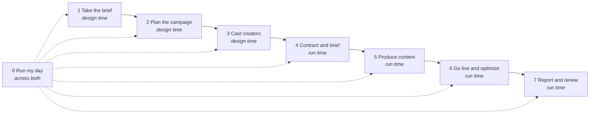

# Story map

The whole job, end to end, from the primary persona's point of view (Maya, the Account Manager; see [personas.md](personas.md)), with the agent's part in each step. It is deliberately wider than the prototype: the prototype is one thin vertical slice through it, marked **▲ Prototype**. Stories are written as *As Maya, I want…* unless another persona is named.

How to read it: the **backbone** runs left to right in the order a campaign is lived. Each activity breaks into **steps**. Under each step, stories are sliced into releases:

- **▲ Prototype**: built in the demo (scripted agent).
- **R1, walking skeleton**: the smallest version that would run one real campaign end to end with the agent mostly proposing.
- **R2**: the agent acts alone on more action types and the pod shares the record.
- **Later**: valuable, but depends on R1/R2 data or on other teams.

Lanes follow the flows legend: 🤖 agent acts alone · 🤝 agent proposes, Maya approves · 🧑 human only. Each activity is tagged **design time** or **run time** (the conductor agent's two modes, *Interview*).

## Backbone

In the brief, the activities group into three phases: **Plan** (1–3), **Make** (4–5), and **Run** (6–7). Activity 4 is labelled run time in Later's terms, but for the account manager it's part of making the content.

Activity 0 is the supervisory layer that sits over all the others: the queue, the log, and tuning the agent. It's where Maya spends most of her time once the agent runs.

## 0. Run my day (across both)

| Step | ▲ Prototype | R1 | R2 | Later |
| --- | --- | --- | --- | --- |
| See what needs me | 🤝 One ranked queue across accounts, by consequence × time (`#today`) | Filter by account; snooze with a reason | Coordinator view of the same queue, scoped to their work | Mobile digest for between-call triage |
| Understand a card in 10 seconds | 🤝 Title says what happened; evidence per criterion; confidence in words | "Why now?" shows the policy line that was crossed | Ask a scoped question ("why him over her?") | — |
| Act on it | 🧑 One primary action, the rest quiet; resolve once, logged | Reject with a reason | Batch-approve similar low-risk cards, skipping stale ones | — |
| Check what the agent did alone | 🤖 Agent log with actor and undo (`#log`) | Real undo for reversible actions | Attribution across people, rules and agent | Weekly "what the agent did" summary |
| Tune the agent | 🧑 (live demo) change `AGENT_POLICY` | Per-action autonomy setting per account | Repeated corrections propose a policy change | Autonomy earned per CM from reversal rate |
| See portfolio health | 🤝 Account view with campaign widgets in state (`#account/<id>`) | Waiting-on-client vs. waiting-on-us | — | Cross-portfolio pacing for leadership |

## 1. Take the brief (design time)

| Step | ▲ Prototype | R1 | R2 | Later |
| --- | --- | --- | --- | --- |
| Read what the client sent | 🤖 Agent extracts product, audience, markets, timing, budget; shows what it read | Upload brief, call notes, prior campaigns | Pull past campaigns for the account automatically | — |
| Choose the objective | 🤝 Agent proposes awareness / consideration / conversion with its reasoning; Maya can change it | Affiliate (Later Creator) as an objective | — | Full-funnel plans mixing objectives |
| Set KPIs and targets | 🤝 Drafted KPIs with the benchmark used and measurement method; targets editable | Benchmarks from EdgeAI | — | Forecast ranges, not points |
| Close gaps with the client | 🤝 Drafted clarifying questions | 🧑 Maya sends them in her name | Answers flow back and update the draft | — |
| Agree with the client | 🧑 "Ready for client", not final | 🧑 Record what the client agreed | Seal the milestone; changes need a reopen | — |

## 2. Plan the campaign (design time)

| Step | ▲ Prototype | R1 | R2 | Later |
| --- | --- | --- | --- | --- |
| Turn goals into a plan | — | 🤝 Plan as the conductor's "bill of materials": tiers, creator count, deliverables, workback, reserve | Variant-aware plan (product shipped or not) | Plan templates learned from past campaigns |
| Set match criteria | 🤝 Criteria shown on the lineup as already approved | 🤝 Approve criteria before the search | Brand suitability and polish from Later's existing checks | — |
| Set the workback | — | 🤖 T-14 brief, T-7 draft, T-3 approval, T-0 live | Legal gate for regulated categories | — |
| Hold a reserve | — | 🧑 Reserve size and client-approval threshold | — | — |

## 3. Cast creators (design time)

| Step | ▲ Prototype | R1 | R2 | Later |
| --- | --- | --- | --- | --- |
| Find candidates | 🤖 Roster first, then the wider index; "On roster / New to us" | Rediscover past and shortlisted creators | — | — |
| Screen them | 🤖 Conflicts and brand safety flagged with evidence | Rights and availability checks | Talent-manager routing | — |
| Review the lineup | 🤝 Met / partly / not met per criterion; In lineup / Backup / Remove (`#lineup/<id>`) | Ask why; swap from suggestions | 🧑 *Theo:* add relationship notes the agent can't know | — |
| Check it adds up | 🤝 Fees vs. budget and forecast vs. target, live | Tier mix vs. plan | — | — |
| Approve internally | 🧑 "Approve lineup"; nothing goes to the client yet | — | — | — |
| Present to the client | — | 🤝 Agent drafts the client deck; 🧑 Maya presents | Client approves in a front-desk view | — |

## 4. Contract and brief (run time)

| Step | ▲ Prototype | R1 | R2 | Later |
| --- | --- | --- | --- | --- |
| Make offers | — | 🤝 Offers within the approved rate band | 🤖 Within-band offers to roster creators | — |
| Negotiate terms | — | 🧑 Out-of-band rates, exclusivity, managers (*Theo*) | — | — |
| Collect what's needed to brief | — | 🤖 Milestone checklist in any order: rate, rights, whitelisting, product, disclosure | Conflict cards for colliding updates | — |
| Ship product | — | 🤖 Track shipment and receipt (only if gifted or seeded) | — | — |
| Send the brief | — | 🤝 Brief from the plan | 🤖 Auto-send when the milestone is complete | — |

## 5. Produce content (run time)

| Step | ▲ Prototype | R1 | R2 | Later |
| --- | --- | --- | --- | --- |
| Remind on cadence | 🤖 Two reminders sent alone (T-10, T-8), in the log | One reminder per idempotency key | 🧑 Per-creator preference ("calls, not texts") | — |
| Notice silence | 🤝 **Hard moment:** escalation when slack, history and backup cross the line | — | Quiet before the deadline, not only after | — |
| Recover | 🧑 Call brief: what the agent knows, what to ask, what each answer means | 🤝 Extend, or swap to the pre-approved backup in one click | 🤖 Reliability event logged to the roster | — |
| Check drafts | 🤝 Exceptions first: failed check with evidence, drafted fix request (`#today`) | Draft-review checker integrated (*Interview*: exists today) | Separate surface for validating the checker's accuracy | — |
| Get brand approval | — | 🤝 Consolidated brand feedback | 🤖 Polite chasing of brand review, through Maya | — |
| Tell the client about slips | — | 🤝 Draft note only if go-live or KPI is affected | — | — |

## 6. Go live and optimize (run time)

| Step | ▲ Prototype | R1 | R2 | Later |
| --- | --- | --- | --- | --- |
| Verify the post | — | 🤖 Link, code, tags, disclosure checked | 🤝 Fix request if non-compliant | — |
| Pace against forecast | 🤝 Below-forecast card with expected vs. actual | 🤖 24h / 48h / 72h metric pulls | — | — |
| Boost what works | 🤝 Boost from reserve, only if whitelisting is in contract | 🧑 Client approval above threshold | Rights-extension proposal | Programmatic boosting within guardrails |
| Fix what doesn't | 🤝 Plan next-wave changes | Swap or drop creators in the next wave | — | — |

## 7. Report and renew (run time)

| Step | ▲ Prototype | R1 | R2 | Later |
| --- | --- | --- | --- | --- |
| Status updates | — | 🤝 Agent drafts the weekly status; 🧑 Maya sends | — | — |
| Wrap report | — | 🤝 Agent assembles data and drafts | 🧑 Narrative stays human | — |
| Pay creators | — | 🤖 Chase internal approvals | 🤝 Release on verified delivery | — |
| Learn for next time | 🤖 Roster reliability produced by the agent's own work (`#roster`) | Performance feeds the roster | — | Plan templates and benchmarks from history |
| Renew | — | — | 🤝 SBR draft | Next-objective suggestion |

## The slice the prototype takes

The ▲ stories form one thin path through the map: **0 → 1 → 3 → 5**, with 6 and the roster for context. It covers the brief's three required moments: stating the goal (activity 1), reviewing the lineup (activity 3), and a hard moment (activity 5). It also covers the supervisory layer (activity 0) that makes them one job instead of three demos. Activities 2, 4 and 7 are cut from the prototype because they add screens without adding new trust patterns: they reuse *approve a plan* and *decide an exception*.

### Explicitly not in the prototype

Described in these docs, deliberately not built:

| Area | Not built | Why |
| --- | --- | --- |
| The agent | A real LLM; any real integration (Later Influence, EdgeAI, the draft checker) | Timebox; the behaviour is scripted |
| Activity 2: plan | The bill of materials, workback, reserve setup, approving criteria before search | Reuses *approve a plan* |
| Activity 4: contract and brief | Offers, negotiation, the any-order milestone checklist, shipping, sending the brief | Reuses both patterns; contracts belong to Talent |
| Activity 6: go live and optimize | Post verification, Measure and Amplify views, boosting from the reserve, micro-experiments | After launch; money needs its own guardrails |
| Activity 7: report and renew | Status updates, wrap reports, payments, SBRs | Reuses *approve a plan* |
| Screens | Asset screen; portfolio grouped by need; campaign tabs; coordinator view | Depth, not new patterns |
| People | Creator intake (Creator Operations); talent-manager routing; client front-desk view | Other orgs and surfaces |
| Plumbing | Concurrent edits, conflict cards, idempotent sending, real undo, the detailed trace (versions, prompts) | Invisible in a single-user demo |
| Control | Per-creator preferences, per-account autonomy settings, policy proposals from repeated corrections | Shown live by editing `AGENT_POLICY` instead |

## Ranking R1 (CFS)

Candidate agent tasks for R1, scored Commonality × Frequency × Severity on a 1–5 scale (from "CFS: Scoring Features Before You Argue About Them"). The scores are *Invented* estimates to be replaced after shadowing a pod.

| Agent task | C | F | S | CFS | Why |
| --- | --- | --- | --- | --- | --- |
| Reminders and quiet-creator escalation | 5 | 5 | 4 | 100 | Every campaign, daily, and a miss reaches the client |
| Draft check, exceptions first | 5 | 4 | 4 | 80 | Every deliverable; the checker already exists |
| Post verification (link, code, disclosure) | 5 | 4 | 4 | 80 | Every post; FTC liability |
| Status update drafting | 5 | 4 | 3 | 60 | Weekly per account; low risk |
| Lineup proposal with evidence | 4 | 2 | 5 | 40 | Once per campaign, but it shapes everything after |
| KPI framework drafting | 4 | 2 | 4 | 32 | Once per campaign |
| Boost from reserve | 3 | 2 | 3 | 18 | Only with whitelisting; money needs a person anyway |
