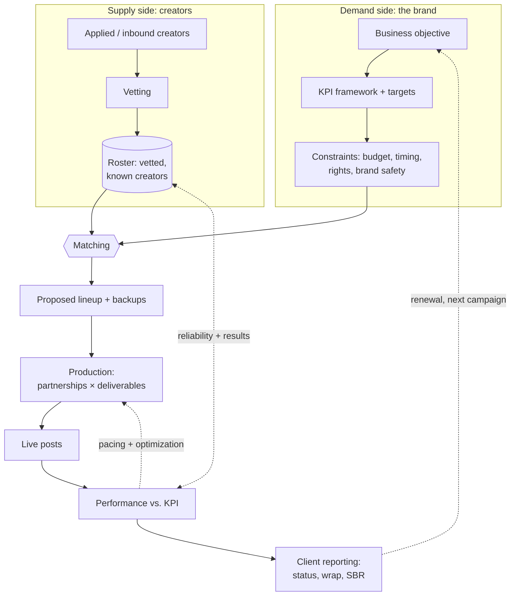
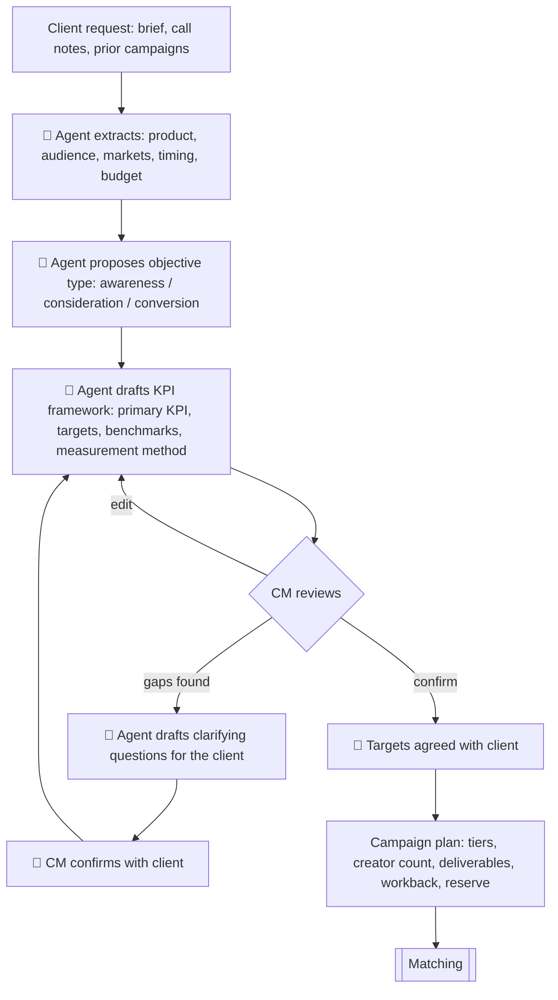
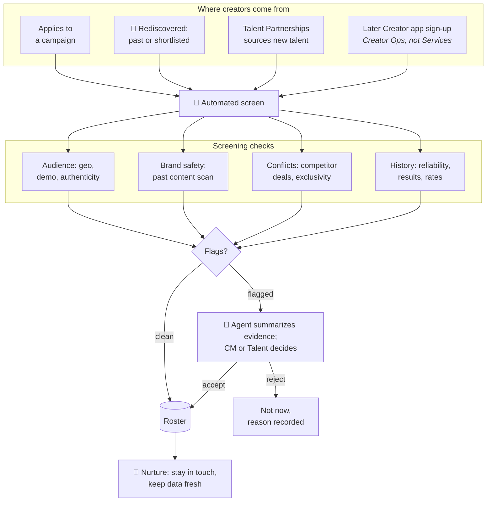
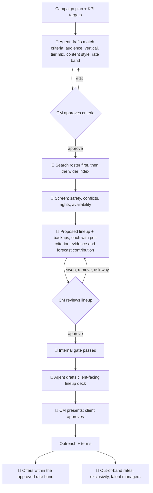
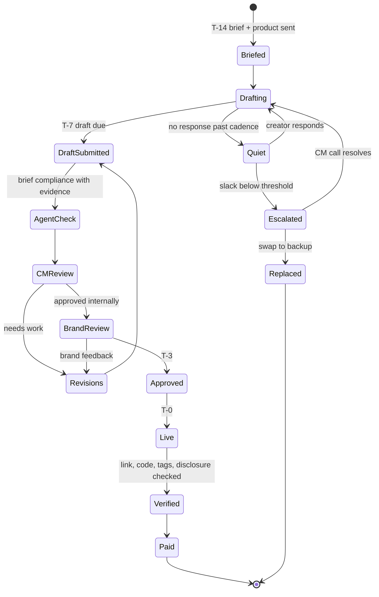
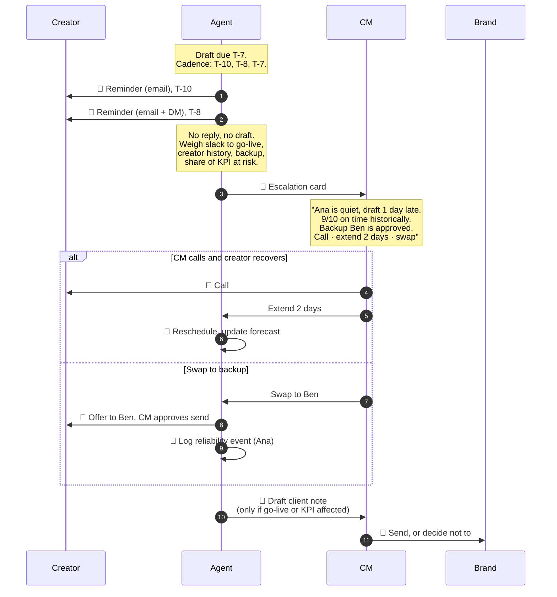
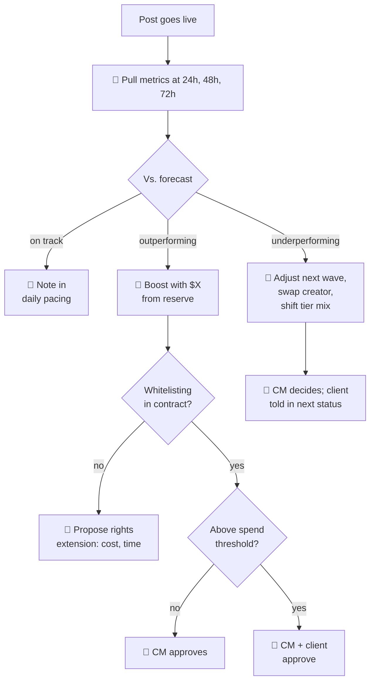
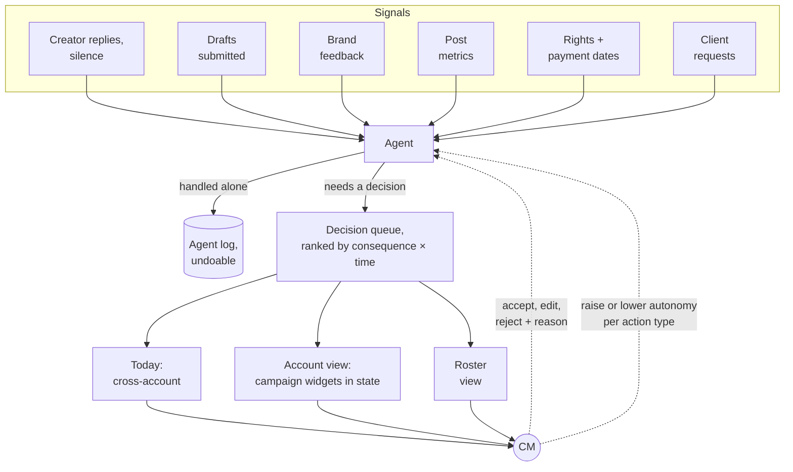
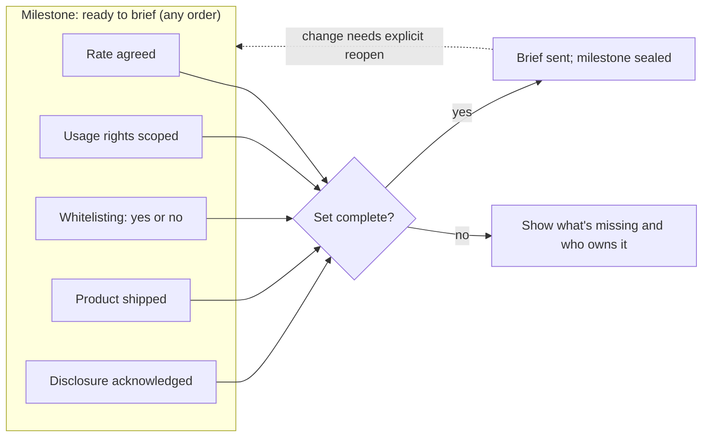
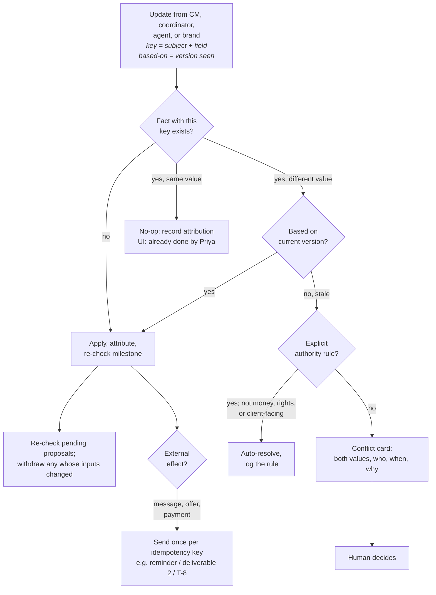

# Flows

How information moves through the system. Diagrams are Mermaid, so they render on GitHub and in VS Code with `bierner.markdown-mermaid`. The reasoning behind them is in [discovery/framing.md](discovery/framing.md).

Legend used in the swimlane notes: 🤖 the agent acts alone (logged, undoable) · 🤝 the agent proposes and the CM approves · 🧑 the human only.

## 1. The system at a glance: two sides meeting at the partnership

The loops matter more than the line. **Performance feeds the roster** (the roster also informs what performance to expect): every campaign updates what we know about each creator's reliability and results, which makes the next match better. **Reporting feeds renewal**: the account comes back with the next objective. That second loop is how the AM is measured.

## 2. Demand side: objective to KPI framework (the "state the goal" moment)

| Objective | Primary KPIs | Measurement caveats |
| --- | --- | --- |
| Awareness | Reach, impressions, video views, CPM | Platform-reported; reach is estimated |
| Consideration | Engagement rate, saves, shares, CTR, CPE, sentiment | Engagement rate varies hugely by tier |
| Conversion | Attributed revenue, codes, affiliate sales, CPA, ROAS | Codes leak and undercount the halo effect; agree the method up front |
| (Reported, contested) | EMV | Later uses the Ayzenberg index; many clients distrust it |

## 3. Supply side: creator intake, vetting, and the roster

Most new-creator intake belongs to Creator Ops, not Services. For a CM, the supply side is mostly **the roster**: who I trust, who delivers, who performed for whom.

## 4. Matching: building and reviewing the lineup

Approving the criteria *before* the search means the agent's later reasoning can be checked against something the CM already agreed to. That is the recruiting pattern (LinkedIn, Ashby).

## 5. Production: one deliverable's life

## 6. Hard moment: a creator goes quiet with a deadline close

What makes this "hard" rather than a cron job: the escalation threshold depends on **slack, substitutability, and history**. The agent's job is to reduce the decision to a call with the context already loaded, and to keep the client informed only when it actually matters.

## 7. In-flight optimization and budget pacing

This replaces the original "tranche" idea. Creator fees are mostly committed at contracting, so the levers are the **reserve**, the **next wave**, and **swaps**.

## 8. The CM's day: from signals to the decision queue

Rejections with reasons are the agent's training signal, and the record of how autonomy is earned.

## 9. Order-independent updates and conflicts

Facts arrive in any order up to a milestone, and the same update may be repeated by different people as part of overlapping batches. Principles are in [discovery/framing.md](discovery/framing.md) §6.

