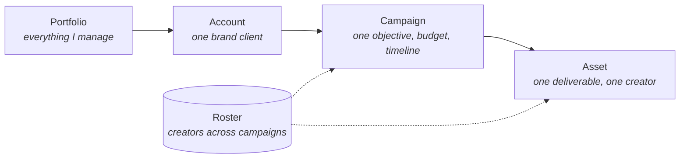

# Information architecture

How the screens fit together: one stable layout, a small number of core objects, and a path from the whole portfolio down to a single asset. This is a *design position*. Object names and screen splits are *Invented* and are the most likely things to change once we shadow a pod ([principles §11](principles.md#11-what-this-work-is-not)).

## 1. One layout everywhere

```text
┌──────────────────────────────────────────────────────────────────────┐
│  Later · Portfolio › Brightside › Holiday gifting   [ Find or ask ⌘K ]   Maya ▾ │  ← top nav
├───────────────────────────────────────────────────┬──────────────────┤
│                                                   │  Widget rail     │
│   Core context (~70–75%)                          │  (~25–30%)       │
│                                                   │                  │
│   The current object and the work on it:          │  2–4 widgets     │
│   forms, boards, review, decisions.               │  chosen for this │
│   The existing product lives here.                │  context. Can    │
│                                                   │  collapse or be  │
│                                                   │  absent.         │
└───────────────────────────────────────────────────┴──────────────────┘
```

| Region | Job | Rules |
| --- | --- | --- |
| **Top nav** | Where am I, and how do I get somewhere else | A breadcrumb shows the object path (portfolio › account › campaign › asset). **Find or ask** sits top center so the command palette has a visible home as well as a shortcut (⌘K or `/`; the key doesn't matter). |
| **Core context** | Do the work | Holds the current object's workflow: forms, boards, review, decisions. All primary actions happen here. In early releases this is the existing product, improved in place. |
| **Rail** | Support the work without being part of it | 2–4 self-contained widgets selected for the current object and state ([principles §8](principles.md#8-widgets-are-self-contained-and-selected-never-generated)). It can appear, collapse or disappear with context, and the core never depends on it. |

**Find or ask, step by step:**

1. **At rest:** the entry sits top center. ⌘K or `/` focuses it.
2. **Typing:** the palette takes over the screen and everything else goes behind a mask. It suggests places to go ("Ana · TikTok 1"), common actions ("nudge Ana"), and always **Start a conversation about** the current object.
3. **Typing more:** as the query grows, navigation and actions stop matching. Eventually only the conversation is left.
4. **Conversation:** the input moves to the bottom and the exchange fills the screen. It carries the current location and the data behind it, so "how does this compare with Ana's last three?" needs no further explanation. Answers can be text or a widget from the library.
5. **Docked:** the conversation moves into the rail, so it continues beside the work and follows you as you navigate.

## 2. The core objects

Like Reva, the product works around a few objects, and every screen is about one of them.



- **Portfolio** is project management across everything. It's the top-level screen for an account manager or anyone else with a book of work.
- **Account** is one brand: its campaigns, health, renewal, and what's waiting on the client versus on us.
- **Campaign** is one project. It is made of **asset slots**, the deliverables the plan calls for. Each asset is tied to one creator.
- **Asset** is the smallest unit: one deliverable from one creator, through drafts, approval, going live and results.
- **Roster** cuts across these. It's the creator-centric view (reliability, history, fit), reached from any asset or lineup.

**Over-casting is normal.** If a campaign needs 10 assets, the account manager may line up 12–14 creators so there are backups. The model treats a campaign as *slots* filled by *candidates*, so a backup is a first-class state and not a workaround. That's also what makes the hard moment's one-click swap possible ([flows §6](flows.md#6-hard-moment-a-creator-goes-quiet-with-a-deadline-close)). *Invented ratio; ask a pod.*

## 3. The portfolio groups by what's needed, not by name

The portfolio is a dashboard organized by **state and next need**, not an alphabetical list of accounts:

| Group | Meaning | Example |
| --- | --- | --- |
| **Blocked** | Can't move until something is decided | Lineup awaiting your approval |
| **Ready to move** | The next step is yours and it's ready | Three drafts passed checks; approve to schedule |
| **Waiting on someone** | Someone isn't responding | Ana hasn't replied in 4 days; brand review at 72h |
| **Do a thing** | A task with a date | Send Brightside's weekly status |
| **On track** | Nothing needed; collapsed to a count | 11 campaigns |

This is the [decision queue](discovery/key-paths.md#path-1-start-the-day) seen from the portfolio level. **Today** (in the personas, key paths and prototype) and **Portfolio** are the same screen: "Today" names the habit (start the day here) and "Portfolio" names the object. Account and campaign screens apply the same grouping to their own scope.

## 4. A campaign has three phases

A campaign screen has three working areas, matching the phases in the brief: **Plan → Make → Run**. They follow the campaign's lifecycle, but you can open any of them at any time.

| Phase | Question it answers | Contents | Later's terms |
| --- | --- | --- | --- |
| **Plan** | Are we set up to succeed? | Goal and KPIs, match criteria, lineup and backups | Design time |
| **Make** | Are the right assets getting made? | Briefs, nudges, drafts, approvals, scheduling | Run time, part 1 |
| **Run** | Is it working, and how do we push what works? | **Measure:** KPIs against targets, pacing against forecast, per-asset results, comparable campaigns. **Amplify:** boosts from the reserve, small tests, next-wave changes | Run time, part 2 |

The campaign's state picks the default tab: Plan until the lineup is approved, Make until the first post is live, Run after that. All three are always one click away. A card can belong to a tab the campaign doesn't open on, for example a quiet creator (Make) on a campaign already in Run. The default tab stays tied to the phase, so the screen is predictable; the tab shows a count of open cards, and every card links its campaign name to the tab that holds it. *Open question: whether Amplify belongs to the account manager or to Paid Media.*

## 5. The throughline: always know where you are and what's next

- **The breadcrumb is the map.** Every screen shows its place in portfolio › account › campaign › asset, and each level is a link.
- **"What's next" goes with you.** Each level shows the top item from the queue for that scope. A decision card looks the same on the portfolio, account and campaign screens, and resolving it in one place resolves it everywhere.
- **The rail follows the object.** On an asset it shows the creator's history and comparable creatives. On a campaign it shows pacing and recent activity. On the portfolio it shows what the agent did overnight.
- **The palette jumps across levels.** It's a shortcut and doesn't replace navigating the hierarchy.

## 6. How the prototype maps to this

| IA | Prototype today | Still a gap |
| --- | --- | --- |
| Top nav with Find or ask | Top bar with breadcrumb and Find or ask (⌘K or `/`); the palette offers Go to, Do, and "Start a conversation about…" | The left sidebar stays alongside, so the existing navigation keeps working |
| Portfolio grouped by need | `#today`, grouped by `needOf` in `app/src/agent/needs.ts`; ranked within each group | Do a thing has no task source yet beyond below-forecast |
| Account | `#account/<id>` | — |
| Campaign: Plan and Make | `#campaign/<id>/plan` and `/make`; Plan links to `#goal` and `#lineup` | Goal and lineup open as their own screens, not embedded |
| Campaign: Run (Measure, Amplify) | `#campaign/<id>/run`: KPI pacing, reserve, and boost and below-forecast cards | Per-asset results |
| Asset | Within campaign rows | — (cut) |
| Rail | 2–4 widgets chosen by a rule (`selectRail()` in `app/src/components/rail/select.ts`): summary, compare to similar campaigns, next scheduled message, and recent activity; no rail on goal, roster, or activity | The rule is hand-written; the creator-history widget for an asset doesn't exist |
| Conversation | Docks in the rail and follows the page; scripted answers in text or the compare widget | Answers are scripted, not generated |
