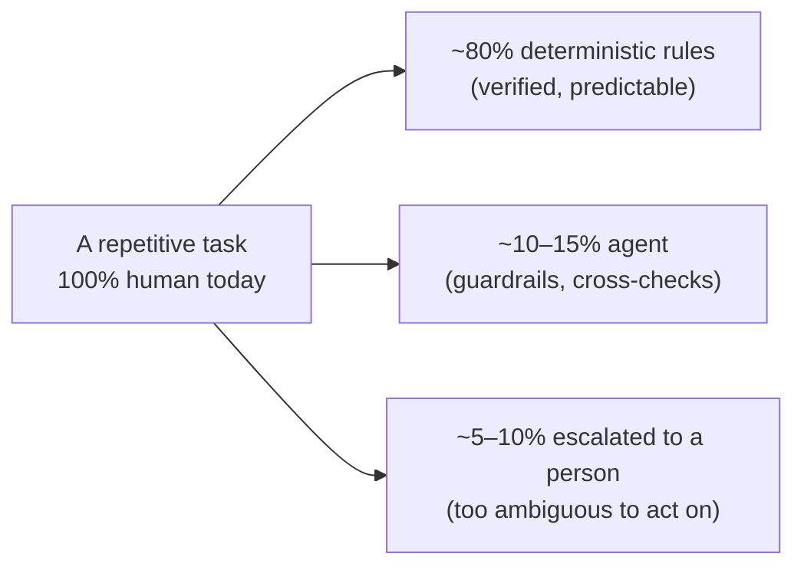

# Product principles

The beliefs behind the prototype. Each one is a working position, not a research finding. [Framing](discovery/framing.md) tests the domain assumptions against public sources, and this page covers the product and interaction philosophy. Everything here may change once there is real user research ([§11](#11-what-this-work-is-not)).

Unless marked otherwise, every claim here is a *design position* (my own judgement, not *Public* or *Interview*). Percentages and examples are *Invented*.

## 1. Evolve the product in production; don't replace it

Later Influence is already in production, and account pods use it every day. The agent arrives as a series of improvements to the workflows people already know, not as a new product they have to relearn.

- **Change at the pace people can absorb.** If we change too much too fast, users get frustrated, work around the tool or abandon it, and the agent never gets the chance to earn trust.
- **The existing UI stays home.** Navigation, objects and workflows remain where they are. The first versions add information, remove steps and simplify decisions inside those workflows.
- **New capability is additive and opt-in.** Power-user surfaces (command palette, widget rail, chat) are layered on top, so someone who ignores them loses nothing.

## 2. One record, any actor

Anything AI can do (automate, assist, decide, or help someone decide) can also be done by a rule or by a person. All three write **the same record** in the same place in the UI. The only difference is *who did it*.

The same entry is shown at three levels of detail, depending on who's looking:

| Who's looking | What they see as the author | Example |
| --- | --- | --- |
| **Outside the pod** (creator, client) | The account manager's team, always | Email to Ana: *from Maya's team* |
| **The pod** | A person's name, or **system** | `Draft reminder sent to Ana · system` · `Called Ana · Jordan` |
| **Engineering, product, QA** | Exactly which rule or agent, its version, the prompt and inputs, and the output | `rule draft-cadence@v3, T-8` · `agent nudge@2026-11-14, prompt #a91f, inputs…` |

- **Outside the pod, nobody sees the machinery.** A creator or client never needs to know whether a person, a rule or an agent sent something. It comes from the account manager's team, and she owns it.
- **Inside the pod, "the system did it" is enough.** Most people don't distinguish between a rule and an agent, and the mix will change over time as agent work moves into rules ([§3](#3-rules-first-agent-for-the-exceptions-human-for-the-ambiguous)). Showing the distinction would change people's expectations every time it shifts. What matters is whether a person or the system acted.
- **Every actor reads the same history.** People and the system all see "last reminder sent 2 days ago," so nobody double-sends. Anti-spam limits (for example, at most one reminder per creator per 48 hours) are enforced on the record itself, regardless of who sends.
- **Nothing is hidden.** The system acts on my behalf but never out of sight. I can see what happened, who did it and when, then act on it, undo it where possible, or turn that behaviour off.
- **What has happened can't be edited.** Attribution and undo apply where an action is still reversible. Once something has happened outside the system (an email sent, an offer made, money spent), that entry is permanent. The fix is a new action, such as a follow-up, which gets its own entry. That makes the record an audit trail, not just a history.
- **The full trace is what improves the system.** Versioned, attributed records are how problems get diagnosed, and how repeated agent behaviour gets found and turned into rules.

## 3. Rules first, agent for the exceptions, human for the ambiguous

Agents are a good way to *discover* which repetitive work can be automated. Over time most of that work should move into plain rules and small functions, which are cheaper, faster and easier to verify. The agent's long-term job is the exceptions.

Don't use a model where a rule will do, the same way you don't use the largest model when a smaller one is good enough. Rules give the same answer every time; models don't. The full trace in [§2](#2-one-record-any-actor) is how repeated agent behaviour gets found and rewritten as code.

*Illustrative split, not a measurement.* Trust follows from the shape: most outcomes are discrete and reliable, the agent never takes an extreme position, and ambiguity goes to a person instead of being guessed. When every outcome is recorded the same way ([§2](#2-one-record-any-actor)), people can check that the rules are correct and are implemented correctly, and in my experience most of them get comfortable with that quickly.

## 4. Ask less, so the asks matter; enforce limits in code

**Approval only protects anything if people actually read it.** If the account manager's job becomes approving everything the agent suggests, approval becomes a reflex: people click "continue" without reading. Coding agents showed this; reducing how often they ask is what made the remaining prompts worth reading. So:

- **New kinds of action start gated,** especially messages to creators or clients and spending money.
- **They move to automatic as the record shows they're safe.** Routine reminders, small capped tests and low-risk spend should be automatic early, once testing supports it.
- **Escalation paths stay deliberately few,** so an escalation means *this one is different*, and gets read.

**Guardrails are rules and code, not prose.** Telling a model not to do something in its prompt is not a guardrail: models do things they were explicitly told not to. Limits are enforced outside the model, by deterministic checks it can't argue with:

- *Thresholds and caps:* the agent may spend up to $200 per test, capped at $1,000 per campaign per day. Two $200 buys over the cap, or one $20,000 buy, are blocked and escalated. *Invented figures.*
- *Pattern matching* on things that always need a person (legal terms, complaints, client-facing claims).
- *Adversarial review:* a separate check, ideally not the same model, reviews what the agent proposes before it goes out.

## 5. Control is contextual

Autonomy is set per action type ([autonomy lanes](../design-system/02-ai/autonomy-lanes.md)) and can be narrowed for a specific creator, account or situation.

- *A sensitive creator:* the agent doesn't message them. It reminds **me** to get in touch.
- *A creator who prefers phone calls:* the agent alerts me by email or text, I make the call, and the call is logged against the same record (automatically, if call capture is available). See [flows §6](flows.md#6-hard-moment-a-creator-goes-quiet-with-a-deadline-close).
- *Any action type:* I can lower the agent's autonomy from **acts** to **proposes** to **off**, and the change is logged too.

## 6. Forms first; chat when the input is genuinely unstructured

Conversation is useful, but it is not the main way an account manager works. Most work is filling in a form, writing a message, reviewing copy, and approving or declining. Those stay as direct, traditional UI. Chat is there when the question is open-ended ("compare this account's last three campaigns") and is always reachable, never required. (Background: "Chat Is an Input, Not an Interface," [research](discovery/research.md#prior-writing-joshua-hall-medium).)

**Most decisions take one of four outcomes.** Approving a creator's draft, a lineup member or a proposal comes down to:

1. **Approve**, as is.
2. **Approve with conditions**: "make these changes."
3. **Decline unless**: "we'd go ahead if you change these things."
4. **Decline.**

Options 2 and 3 collect the conditions *after* the choice. This matches Later's own draft review states (Approved / Approved with Corrections / Needs Work) and the shape of rental-application screening. The UI's job is to collect and infer what the person would otherwise have to gather by hand, and then reduce the decision to these few choices.

## 7. Five ways AI shows up in the interface

| # | Surface | What it does | Value |
| --- | --- | --- | --- |
| 1 | **Command palette** | Navigation and simple workflows; the entry point for power users | Speed for experts; nothing changes for everyone else |
| 2 | **Chat, from the palette** | When typing no longer matches a place or action, it becomes a conversation about the current object. It knows where you are, answers with text or widgets, and can dock in the rail | Flexibility when the question has no form |
| 3 | **Widget rail** | About 25% of the screen on the right, filled with 2–4 widgets chosen for the current context | The right supporting information without searching for it |
| 4 | **Context at the decision point** | Collects what a person would otherwise look up before deciding (history, benchmarks, comparable campaigns) and shows it as evidence on the card. The decision itself is the four outcomes | **The most value.** Faster and better decisions |
| 5 | **First drafts and feedback** | Writes the first draft of creator briefs, feedback and outreach for a person to review ("this phrase did better than that one with this audience") | Fewer revision rounds, fewer errors and omissions |

Surfaces 4 and 5 are where the real value is. Surfaces 1–3 are how people reach them.

**First drafts, in more detail.** A good brief is tailored to each creator and gives the right amount of context without over-specifying. The agent can draft "the five things that matter most for *your* piece of this campaign" from the brief, the creator's history and what worked in similar campaigns. If that turns five or six rounds of revisions into two or three, the creator, the account manager and Later's margin all benefit. Efficiency is the lever we can measure first. Efficacy (better results) is harder to measure and needs research.

## 8. Widgets are self-contained and selected, never generated

One fixed library of well-defined widgets serves three places: the **rail**, **answers in a conversation**, and eventually the **core screens**. The rail draws from it like this: In a campaign's context there might be a dozen candidates. The model picks the 2–4 that fit what the data shows, and fills them. As patterns become clear, a deterministic rule takes over that choice ([§3](#3-rules-first-agent-for-the-exceptions-human-for-the-ambiguous) again).

**Ambiguous asks get interpreted, and the interpretation is shown.** "Compare this asset with her last three" could mean wording, audience and expected outcome, or actual results. If the asset is live, the useful comparison is early performance against her previous posts at the same point, to see whether it's on pattern and predict where it will land. The agent picks a dimension, says which one it picked, and offers the others.

**How this could be built** (*design position; not built*). Several specialist agents and skills, orchestrated with something like LangGraph: one interprets the request, one chooses the widget, one fills it. Two emerging protocols fit: **A2A** for agents handing work to each other, and **A2UI** (Google), where an agent can only request components from a catalog of approved components the app owns. That's the "selected, never generated" rule, enforced by the protocol.

Example widgets: *compare to similar campaigns · suggested next steps · recent activity · next scheduled message (send now or edit)* · *comparable creatives and what worked with this audience*.

**Each widget declares the data it accepts.** A cost widget might take CPM, cost per click, cost per view or cost per sale, from different sources, and show each in the right form. Which sources and types a widget supports is part of its contract, so the agent can only pick widgets that fit the data available.

**Each widget handles two kinds of responsiveness:**

- **Space:** its own layout from narrow rail to full panel.
- **Data quantity:** different designs for **0, 1, about 10, about 100 and 1,000+** items. Comparing against one past campaign is a side-by-side view, against ten it's a ranked list, and against five hundred it's a distribution with the current campaign marked on it. Empty, loading, stale and "already handled" are states too ([framing §6](discovery/framing.md#6-order-independence-and-concurrent-updates)).

## 9. Every campaign makes the next one better

Each campaign adds to the record of what worked, for which audience and with which creator. Campaign N+1 starts with everything learned up to N. The roster's reliability data, the benchmarks behind KPI targets and the phrasing suggestions in feedback all come from that record. That compounding is the long-term case for doing this inside Later rather than with a generic tool.

## 10. The agent can run small experiments

Some decisions are better tested than predicted. With a small, capped share of the amplification budget (for example $5–10 of every $100), the agent can run early micro-experiments: boosting a post against a few audiences, keywords or placements to see where the next dollar works best. It combines those results with this client's history and comparable campaigns, then **proposes** how to split the remaining spend across a small number of buckets (2–5), each with its reasoning and expected outcome.

- The test budget is set up front by a person, is capped, and is logged like any other spend ([§2](#2-one-record-any-actor)).
- The agent proposes the allocation and a person approves it. Spend above the client-approval threshold still goes to the client ([flows §7](flows.md#7-in-flight-optimization-and-budget-pacing)).
- It only works where whitelisting or partnership-ad rights are in the contract.
- This moves toward Later's stated ambition of influencer marketing as a programmatic channel (*Interview*), but one bounded step at a time.

All figures are *Invented*.

## 11. What this work is not

This is a 2–4 hour exercise about what is really the job itself, which would take years to deliver fully. It is an informed guess at direction, not a researched proposal.

**Not done:** user interviews, shadowing account pods, heuristic review of the current product, a working session with engineering on how the data is actually organized (the object model in [information-architecture.md](information-architecture.md) is mine, not Later's), competitive teardown, analysis of comparable industries (CRM, recruiting, rental screening, and medical or financial matching, where complex rules match two parties across many variables, some objective and some not).

**What follows from that:** I'm not proposing the quick wins inside today's UI and navigation, although there are certainly many. Those come out of the research. The first 90 days would be research to find where the current workflows lose the most time and accuracy. CFS scoring would then rank what to build first.
